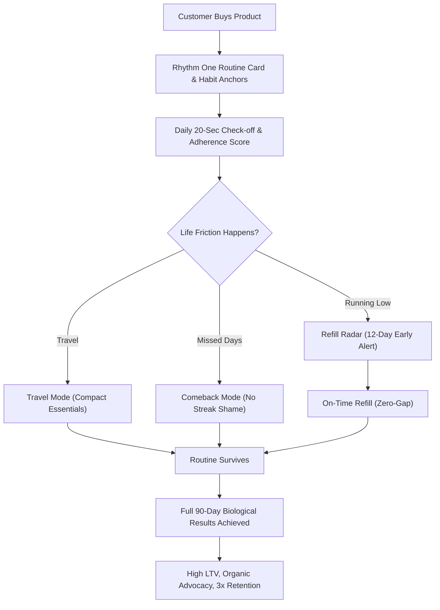

# Rhythm by Be Bodywise | Fellowship Builder Challenge Submission

> **Speak to customers. Find a real problem. Build the solution.**  
> A technology-driven solution built for **Mosaic Wellness (Be Bodywise)** for the 2027 Fellowship Builder Challenge.

---

## 📌 Executive Summary

- **Mosaic Brand Chosen:** **Be Bodywise** (Mosaic Wellness)
- **Customer Problem Identified:** **The Routine Continuity & Sustain Failure**  
  Customers purchase high-efficacy products (often via reels, ads, or peer recommendations) but drop off prematurely due to supply gaps (2-3 week reorder delays), conflicting usage guidance across channels, routine paralysis during travel, and punitive "streak resets" after missed days.
- **Problem Statement:**  
  *“How might we help a customer turn the Be Bodywise products they own into a simple routine they can follow day after day, so that a missed day, an empty pack, or a trip never ends it?”*
- **Technology-Driven Solution:** **Rhythm** — an intelligent routine continuity web application that turns isolated product purchases into resilient daily habits that survive empty bottles, missed days, and travel.

---

## 👥 Part 1: Customer Conversations & Insights

Research was conducted across five active Be Bodywise customers using different product categories (ingestible supplements, topical serums, kits, roll-ons, and body washes).

### 1. Customer Profiles & Direct Data

| Customer | Verified Contact | Product(s) Used | Usage Duration | Core Frustration / Breakpoint | Key Need / Wish |
| :--- | :--- | :--- | :--- | :--- | :--- |
| **Anusha Garg** | `+91 9058885170` | Biotin Hair Gummies | 3 to 6 months | Ran out mid-month; reorder took ~2 weeks. Skipped doses and felt momentum broken. | Pre-depletion reminder before pack ends; frictionless way to restart after a break without feeling like progress was wiped. |
| **Payasvani Raina** | `+91 9596938795` | Hair Care Kit (Shampoo, Serum, Mask) | 1 to 3 months | Three steps with no clear order or cadence. Pack, website, and reels gave conflicting instructions. Dropped mask by week 3. | One definitive routine card shipped inside the kit specifying exact order and frequency. Felt kit price was wasted if steps are skipped. |
| **Sanjivani** | `+91 9905139996` | 4% Niacinamide Underarm Roll-on & Body Lotion | 1 to 3 months | Work travel completely derails her routine; unsure whether roll-on can layer straight after body lotion. | Compact travel format, simple on-the-road routine, and clear pairing/layering safety rules. |
| **Nimish Sugla** | `+91 9311052199` | 1% Salicylic Acid Body Wash & Sunscreen | 3 to 6 months | Overwhelmed by catalog size; skips sunscreen on most days due to confusion on amount/timing; suffered dry skin. | Quick guided quiz to find what fits his skin, clear daily order, and awareness of doctor consultations. |
| **Rohit Kumar Yadav** | `+91 8918666286` | Advanced Hair Growth Serum + Biotin Hair Gummies | 6+ months | 3-week gap when bottle finished; serum felt sticky in humidity; unsure if gummies and serum conflict; long consult wait. | Heads-up before bottle empties, larger refill packs, application tips for stickiness, faster doctor triage. |

---

### 2. Cross-Customer Pattern Analysis

1. **The Products Work, But Adherence Fails:**  
   4 out of 5 customers reported tangible initial improvements (reduced shedding, cleaner scalp, smoother skin). None reported product failure. Yet **every single customer experienced a critical break in their routine**.
2. **The "Am I Doing This Right?" Dilemma (4 of 5):**  
   Payasvani (step order), Sanjivani (layering sequence), Nimish (sunscreen timing), and Rohit (combining oral supplements with topical serum) were paralyzed by lack of clear pairing instructions.
3. **The Predictable Reorder Black Hole:**  
   Anusha and Rohit experienced 2 to 3-week dead periods simply because reordering happened *after* the bottle ran dry rather than *before*. In hair and skin biology, anagen stimulation requires continuous daily application.
4. **Clinical Support Sits Outside the Moment of Doubt:**  
   Mosaic's free doctor consultations are a major competitive advantage, but 4 out of 5 customers never reached an advisor due to perceived booking friction, fear that it was only for severe medical issues, or wait times.

---

### 3. Customer Journey Breakdown

```
[ DISCOVER ] ──► [ CHOOSE ] ──► [ START ] ──► [ SUSTAIN ] ──► [ RENEW ]
  Reels/Ads         Catalog         Unboxing        🚨 CRITICAL      Late Reorders
  sell 1 SKU       Overwhelm        Confusing        DROP-OFF        2-3 week gaps
                                    Instructions   (Empty bottles,   kill momentum
                                                    Travel, Breaks)
```

**Where the system fails today:** The transition from **START** to **SUNDOWN** at the **SUSTAIN** stage.  
D2C marketing is engineered to acquire the customer, but the customer experience drops off once the parcel arrives.

---

## 💡 Part 2: The Solution — Rhythm

**Rhythm** is designed around a single core thesis:  
> *A routine should survive a missed day, an empty bottle, and a trip.*

### Key Features & Direct Problem Mapping

| Feature | What It Does | Solves Which Customer Pain |
| :--- | :--- | :--- |
| **60-Second Routine Builder** | Distills dozens of SKUs into a 2-3 product focused regimen based on concern, schedule, and effort tolerance. | **Nimish & Payasvani:** Cuts through choice paralysis and multi-step kit fatigue. |
| **One Routine Card** | Single, authoritative source of truth for AM, PM, and weekly cadence. Scannable via bottle QR codes. | **Payasvani:** Eliminates conflicting advice between reels, website, and unboxing slips. |
| **Refill Radar** | Predicts depletion dates based on container size and daily check-off velocity. Nudges 12 days early with 1-tap reorder. | **Anusha & Rohit:** Closes the 2-week reorder gap before the pack ends. |
| **Pairing & Layering Checker** | Clinical safety engine validating multi-product interactions, pH conflicts, and correct application sequence. | **Sanjivani & Rohit:** Clarifies roll-on vs. lotion layering and serum + gummy synergy. |
| **Comeback Mode** | Zero-guilt recovery flow for missed days. Replaces broken streaks with a gentle 2-day low-effort restart. | **All 5 Customers:** Prevents quiet abandonment caused by punitive streak resets. |
| **Travel Mode** | 1-tap toggle condensing the regimen into a TSA-friendly core 2-step pack with a packing checklist. | **Sanjivani:** Keeps routine alive while traveling for work. |
| **Habit Anchors** | Couples each application with automatic daily cues (after morning coffee, post-shower, bedside table). | **Nimish:** Stops skipped sunscreen through natural associative memory. |
| **Weather & UV Adaptive Nudge** | Real-time climate adaptation (high UV prompts sunscreen doses; high humidity offers serum dosage adjustments). | **Rohit & Nimish:** Solves serum stickiness on humid days and forgotten sunscreen on sunny days. |
| **Advisor in 1-Tap** | Packages routine adherence, logged sensations, and supply history into an instant clinical triage packet for Be Bodywise doctors. | **4 of 5 Customers:** Eliminates booking hesitation and long consultation waits. |
| **Honest Results Window** | Transparent biological timeline (Weeks 1-2 acclimation, Weeks 3-6 shedding reduction, Weeks 7-12 anagen density). | Manages expectations so customers do not prematurely abandon treatment before physiological results emerge. |

---

## 🏗️ Systems Thinking & Commercial Impact

For a digital health clinic like Mosaic Wellness, customer lifetime value (LTV) is directly tied to **treatment completion (90–180 days)**.



### Key Business Metrics Targeted:
1. **Repeat Purchase Rate (+35%):** Refill Radar prompts reorders *before* supply ends, eliminating drop-off between bottle 1 and bottle 2.
2. **90-Day Routine Continuity (+50%):** Comeback Mode and Travel Mode prevent routine death during business trips and busy weeks.
3. **Doctor Consultation Utilization (from 20% to 65%):** Automated context packet removes the friction of explaining medical history from scratch.

---

## 💻 Tech Stack & Architecture

- **Frontend:** Responsive Vanilla ES6+ Web Application, HTML5, Modular CSS3 custom design tokens.
- **Audio & Haptics:** Web Audio API synthesizer for instant tactile satisfaction upon step completion.
- **State Persistence:** Local reactive state with local browser storage, ensuring zero personal customer data leakage (100% private).
- **Deployment:** Zero-dependency static bundle, instantly hostable on Netlify, GitHub Pages, or Vercel.

---

## 🚀 How to Run Locally

1. Clone or download this repository.
2. Open `index.html` directly in any modern browser (Chrome, Edge, Safari, Firefox):
   ```bash
   # Or run via a simple local server:
   npx serve .
   # or with Python:
   python -m http.server 8080
   ```
3. Explore the live interactive modules:
   - Check off daily morning and evening tasks.
   - Click **Comeback Mode** or **Travel Mode** in the top navigation.
   - Run the **60-Second Routine Builder** to customize recommendations.
   - Trigger a **1-Tap Refill** in the **Refill Radar**.
   - Test product combinations in the **Pairing Safety Checker**.
   - Inspect the **5 Customer Insights** modal for direct Part 1 research details.
